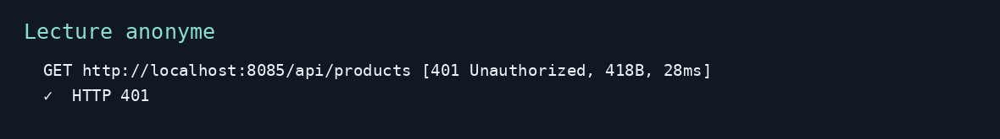
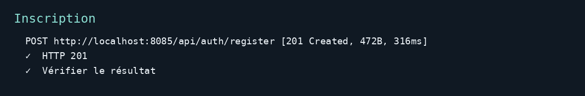
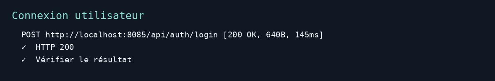
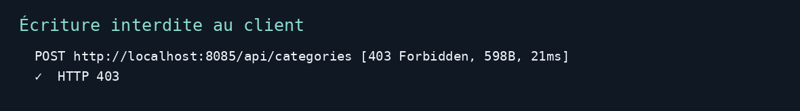
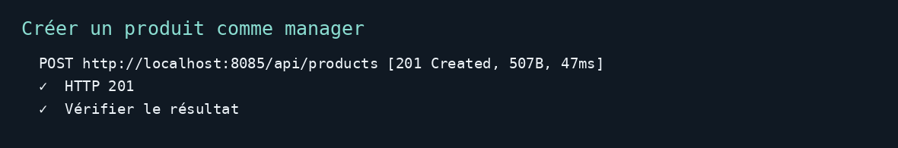
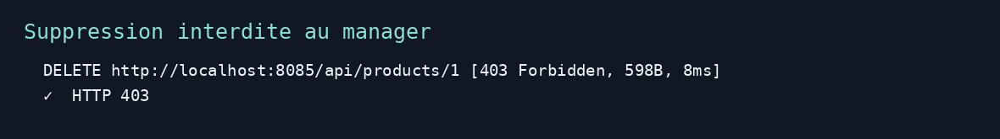
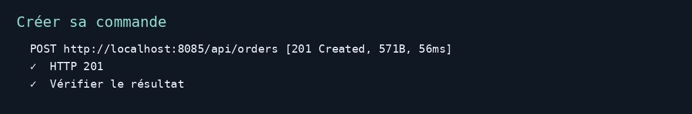
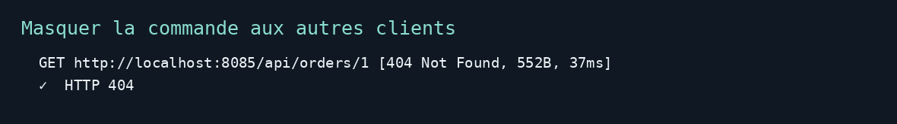
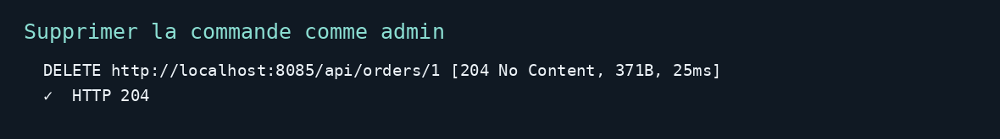
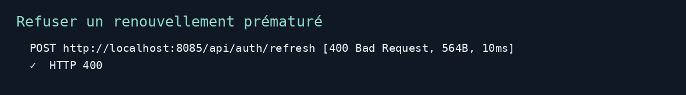

# Lab 4 · Authentification JWT avec Spring Security

L’API du Lab 3 conserve ses catégories, produits et commandes. Le Lab 4 ajoute des comptes persistés, des mots de passe hachés avec BCrypt et des jetons Bearer signés (HS256). Les rôles sont relus en base à chaque requête authentifiée.

## Démarrage

1. Installer Java 21, Maven et Docker Compose.
2. Dans le terminal de lancement, définir `DB_PASSWORD` puis `JWT_SECRET` (au moins 32 octets aléatoires encodés en Base64, par exemple avec `openssl rand -base64 32`).
3. Définir `LAB_ADMIN_USERNAME=lab-admin`, `LAB_MANAGER_USERNAME=lab-manager` et leurs mots de passe `LAB_ADMIN_PASSWORD` et `LAB_MANAGER_PASSWORD` pour créer les comptes de test au premier lancement. Utiliser des comptes et secrets dédiés au test.
4. Lancer `docker compose up -d --wait`, puis `mvn clean verify` et `java -jar target/lab4-api-1.0.0.jar`.

Hibernate prépare les tables. Pour une installation manuelle, exécuter `src/main/resources/db/create-database.sql` et `src/main/resources/db/schema.sql`. Pour une base distante, configurer `DB_URL`, `DB_USER` et `DB_PASSWORD`. Pour une interface web locale, `CORS_ORIGIN` indique l’origine autorisée (par défaut `http://localhost:3000`). L’API utilise des jetons Bearer sans session ni cookie d’authentification.

## Autorisations

| Opération | USER | MANAGER | ADMIN |
|---|---|---|---|
| Lire le catalogue | Oui | Oui | Oui |
| Créer un produit | | Oui | Oui |
| Modifier ou supprimer un produit | | | Oui |
| Écrire une catégorie | | | Oui |
| Lire les commandes | Les siennes | Toutes | Toutes |
| Créer une commande | Oui | | |
| Supprimer une commande | | | Oui |

L’inscription attribue toujours USER. Un accès sans jeton valide renvoie 401. Un rôle insuffisant renvoie 403. Une commande appartenant à un autre client est renvoyée comme introuvable (404).

## Tests

Importer `postman/Lab4-Auth.postman_collection.json`, renseigner `baseUrl`, les identifiants des comptes de test et `demoPassword` dans des variables locales, puis lancer la collection dans l’ordre. Les jetons et identifiants sont transmis automatiquement entre les requêtes. Utiliser la collection sur une base de test.

[Diagrammes de séquence UML](docs/uml/authentication.md)

## Expiration et révocation

Les jetons expirent au bout de 15 minutes et peuvent être renouvelés durant les 5 dernières minutes via `POST /api/auth/refresh`. Pour permettre la révocation ciblée en production, ajouter un identifiant unique de jeton, conserver les identifiants révoqués jusqu’à leur expiration, et les contrôler lors du décodage. La rotation de la clé invalide tous les jetons signés par l’ancienne clé. Une échéance absolue ou des jetons de renouvellement rotatifs permettent de borner la durée d’une session.

## Résultats d’exécution

Le build Maven réussit sous Java 21. Newman valide 18 requêtes et 27 assertions contre le JAR avec H2 en mode MySQL. La configuration MySQL est fournie. Son exécution reste à vérifier. Les images sont générées à partir de la sortie réelle de Newman.

[Journal des tests](docs/newman.txt)

### Lecture anonyme

### Inscription

### Connexion utilisateur

### Écriture interdite au client

### Créer un produit comme manager

### Suppression interdite au manager

### Créer sa commande

### Masquer la commande aux autres clients

### Supprimer la commande comme admin

### Refuser un renouvellement prématuré

